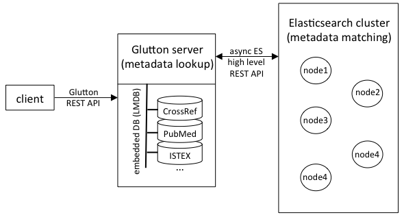

## How it works

Below is an overview of the biblio-glutton architecture. The biblio-glutton server manages locally high performance LMDB databases for all metadata look-up tasks (several thousand requests per second with multiple threads). For the costly metadata matching tasks, an Elasticsearch cluster is used. For scaling this sort of matching queries, simply add more nodes to this Elasticsearch cluster, keeping a single biblio-glutton server instance. 

 

### Runtime evaluation

!!! note
    These figures were measured on an earlier version (machines with an Intel i7 4-cores, 8
    threads, 16GB memory, SSD, on Ubuntu 16.04) and are kept for the order of magnitude. To measure
    a current installation, see [Load testing](Load-testing.md).

1) *Metadata Lookup*

One glutton instance: 19,792,280 DOI lookup in 3156 seconds, ~ 6270 queries per second. 

2) *Bibliographical reference matching* 

Processing time for matching 17,015 raw bibliographical reference strings to DOI:

| number of ES cluster nodes | comment  | total runtime (second) | runtime per bib. ref. (second)   | queries per second |
|----|---|---|---|---|
|  1 | glutton and Elasticsearch node share the same machine   | 2625  | 0.154  |  6.5  |
|  1 | glutton and Elasticsearch node on two separate machines   | 1990  | 0.117  |  8.5 |
|  2 | glutton and one of the Elasticsearch node sharing the same machine  |  1347  |  0.079  | 12.6  |

The machines all have the configuration given above.
